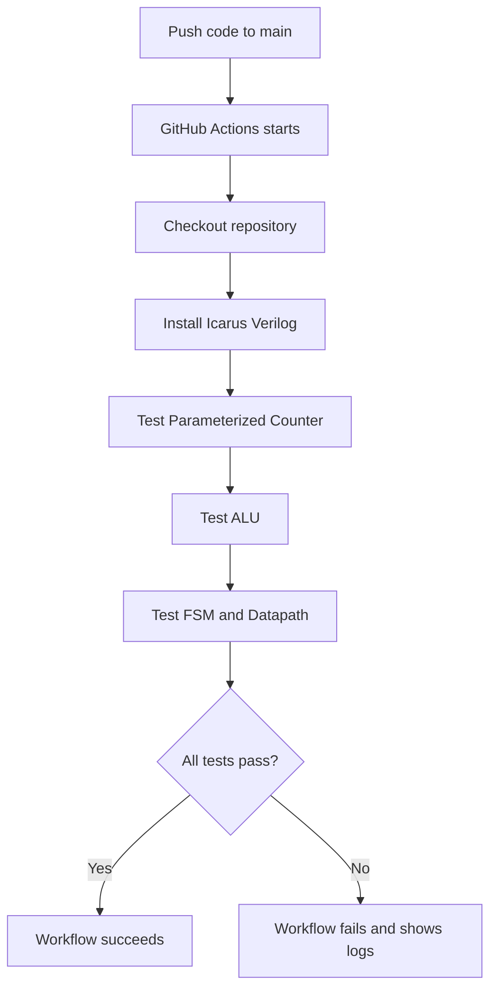

# Automated RTL Verification Flow

## Flow Diagram

## Verification Process

1. A push to `main` or a pull request targeting `main` triggers the workflow.
2. GitHub Actions checks out the repository and installs Icarus Verilog.
3. The workflow compiles and simulates the parameterized counter, ALU, and FSM/datapath.
4. The testbenches check the expected behavior.
5. The workflow succeeds when all commands pass; otherwise, the failure is reported in the Actions logs.

## Tools Used

- GitHub Actions — automated execution
- Icarus Verilog — compilation and simulation
- Verilog/SystemVerilog — RTL and testbenches
- Git and GitHub — version control and CI triggers
